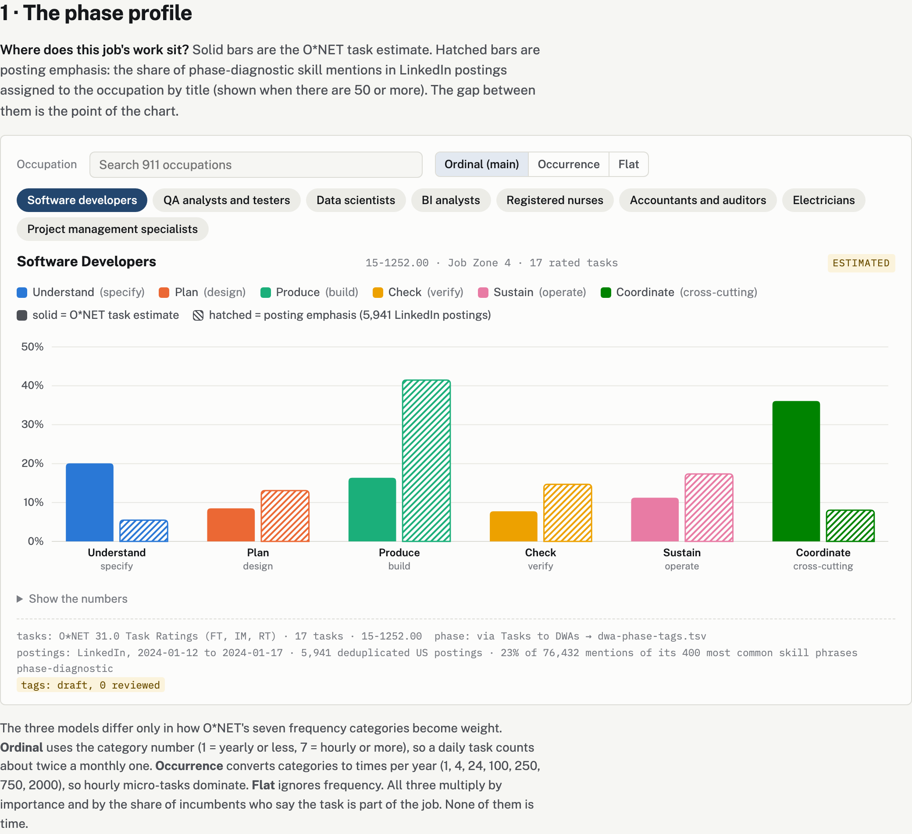
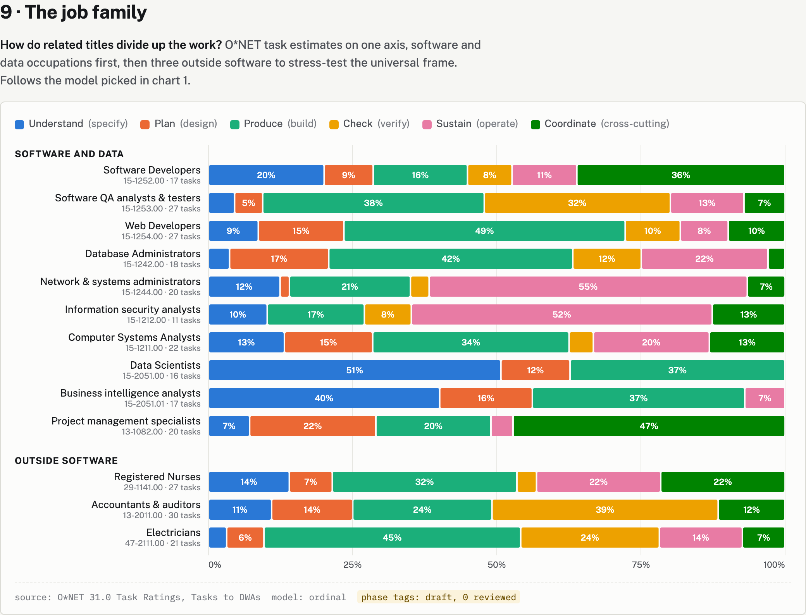
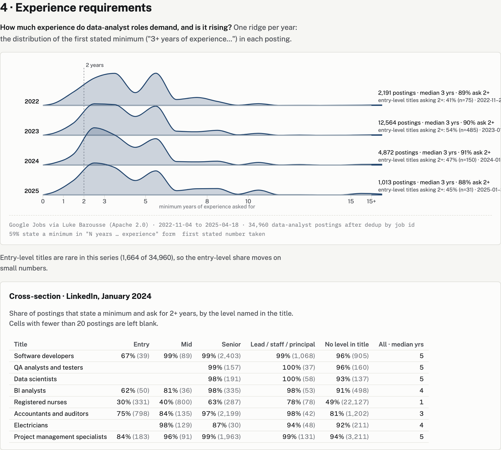

# A New Shape for Work

**How AI is Affecting Jobs**

Data, code and a working prototype for a paper on where a job's work sits, what employers ask for, and where AI use already shows up. Everything here is a first pass built on 2026-11-21: every effort figure is a model, and every phase tag is an unreviewed draft.

**Collaborators are welcome.** The most useful help now is reviewing the draft judgments in `tags/` for occupations you know. [CONTRIBUTING.md](CONTRIBUTING.md) lists the tasks, most of which need no special access.

## Executive summary

- **The prototype works end to end on real data.** O*NET 31.0 task ratings give an estimated effort profile across six phases of work (understand, plan, produce, check, sustain, coordinate) for all 911 occupations O*NET rates. Job postings give a second layer: what employers ask for. The Anthropic Economic Index gives a third: which tasks people already bring to Claude.
- **The layers disagree, and that is the paper's opening.** QA analysts and testers: Check is 32% of the task estimate but 63% of posting emphasis. Software developers: Coordinate is 36% of the task estimate but 8% of postings. Electricians: Sustain is 14% against 49%.
- **AI use is concentrated.** 35% of software developers' estimated effort sits in tasks with observed Claude use, against 6% for registered nurses and 0% for electricians. 435 of the 911 occupations have no covered task.
- **The calibration case passes, loosely.** Software developers come out at 16–22% Produce, inside the 15–30% hands-on coding range from time-use studies.
- **"Every job title" is a data-gathering job, not a modelling one.** The O*NET and AI layers already cover every occupation. The posting layer needs each posting's title mapped to an occupation. Matching against O*NET's 47,839 normalised titles (exact, then longest leading or trailing words) assigned 35% of 1,149,342 US LinkedIn postings to an occupation; 19% had an ambiguous title and 45% matched nothing. 915 occupations received postings and 429 have the 50 needed for charts. The most common unassigned titles ("manager", "assistant manager", "store manager", "physician") are listed for review. [docs/GATHERING-DATA.md](docs/GATHERING-DATA.md) is the step-by-step.

## What the page looks like

The prototype is one static page (`page/index.html`). These screenshots show it with software developers selected; on the page, a search box switches every occupation-level chart to any of the 911 occupations. `python3 -I scripts/take_screenshots.py` regenerates them.


**Chart 1, the phase profile.** Where the work sits across six phases: the O*NET task estimate (solid) against what LinkedIn postings ask for (hatched).



**Chart 8, the AI overlay.** Each phase split into effort in tasks with observed Claude use and the rest, with the job family ranked by covered share.


**Chart 9, the job family.** Thirteen occupations on one axis, including three outside software to test the frame.



<details>
<summary>The other charts: calibration, day-to-day tasks, seniority ladder, requirement stack, experience, rank changes, phase shift</summary>

**Calibration.** Software developers' Produce share under the three effort models, against the 15–30% hands-on coding range quoted in the design brief.


**Chart 7, the day-to-day.** Every rated task for the occupation, grouped by how often it is done. Each bar is the task's phase split, the number is its importance (1–5), and a badge marks tasks with observed Claude use.


**Chart 3, the seniority ladder.** Posting emphasis by the level named in the job title (entry, mid, senior, lead). O*NET has no seniority, so the top bar repeats the task estimate for reference.


**Chart 5, the requirement stack.** The share of postings naming each requirement, split by Skills Lexicon class. Phrases the lexicon does not know yet get their own panel.


**Chart 4, experience requirements.** The first stated minimum years of experience in data-analyst postings, one ridge per year, then by level for the LinkedIn occupations.



**Chart 6, rank changes.** Tools ranked by the share of data-analyst postings naming them, per half-year, Nov 2022 to Apr 2025.


**Chart 2, the phase shift.** Data-analyst postings, 2023 against early 2025, by phase cue phrases in the description text.


</details>

## What is here

| Path | What it holds |
|---|---|
| [research-data/](research-data/) | Downloadable activity and posting tables, data sources, licenses, and reproducibility notes. |
| [page/](page/) | The prototype: `index.html` plus its two data files. Open it through any static server (`python3 -m http.server -d page 8765`). |
| [CONTRIBUTING.md](CONTRIBUTING.md) | How to help: reviewing tags, deciding titles, the page, the cluster step |
| [docs/GATHERING-DATA.md](docs/GATHERING-DATA.md) | How to gather the data and run the analysis for every job title |
| [docs/METHOD.md](docs/METHOD.md) | The phase frame, the effort models, the posting and AI layers, and where each breaks |
| [docs/job-shape-brief.md](docs/job-shape-brief.md) | The design brief the prototype was built from (charts, feasibility, build order) |
| [tags/](tags/) | The judgments: phase tags for O*NET work activities (332 intermediate, 2,087 detailed) and for posting skill phrases, and hand decisions for ambiguous job titles. All `draft`, none reviewed. |
| [docs/screenshots/](docs/screenshots/) | PNG screenshots of the page, one per chart |
| [scripts/](scripts/) | Mac-side steps, in run order (see GATHERING-DATA) |
| [cluster/](cluster/) | Explorer-side extraction (Slurm jobs, stdlib Python) |

Not in git: `source/` (downloaded inputs; `scripts/fetch_sources.sh` recreates it) and `data/` (intermediate outputs; the scripts recreate it).

## Reproduce the prototype

```bash
bash scripts/fetch_sources.sh
python3 -I scripts/phase_tags.py && python3 -I scripts/dwa_tags.py
python3 -I scripts/build_profiles.py
git clone https://github.com/nikbearbrown/skills-lexicon ../skills-lexicon
python3 -I scripts/export_lexicon_forms.py ../skills-lexicon
python3 -I scripts/make_title_map.py
# cluster steps: see docs/GATHERING-DATA.md, steps 4-6
python3 -I scripts/build_postings.py && python3 -I scripts/build_postings_by_occupation.py
python3 -I scripts/build_page_data.py
```

## Status and open decisions

- **Phase tags need review.** The most consequential one: O*NET's "Analyzing Data or Information" is tagged Understand, which sends half of a data scientist's work there.
- **Title decisions need review.** `tags/title-decisions.tsv` holds six draft choices (data analyst, project manager, QA engineer, QA analyst, customer service representative, and account executive excluded).
- **Paper authorship is not decided.** The repository's licence is (see below).
- **Open for collaborators.** See [CONTRIBUTING.md](CONTRIBUTING.md).

## Licence

Copyright (c) 2026 Humanitarians AI Incorporated.

- **Code** (`scripts/`, `cluster/`, `page/index.html`): MIT, in [LICENSE](LICENSE).
- **Data, tags, documentation and screenshots** (`tags/`, `page/data/`, `docs/`, the Markdown files): CC BY 4.0, in [LICENSE-CC-BY.md](LICENSE-CC-BY.md).

The data are built from the sources below, and their attribution terms apply too.

## Data credits

- O*NET 31.0 Database, U.S. Department of Labor, Employment and Training Administration (USDOL/ETA), used under CC BY 4.0. O*NET® is a trademark of USDOL/ETA.
- Anthropic Economic Index, `labor_market_impacts/task_penetration.csv` (dataset commit 4e5f69f), data CC-BY. Method: Massenkoff and McCrory, "Labor market impacts of AI: A new measure and early evidence", 2026-03-05.
- asaniczka, "1.3M LinkedIn Jobs & Skills (2024)", Kaggle, ODC-By. Luke Barousse, "Data Analyst Job Postings (Google Search)", Kaggle, Apache 2.0.
- Skills Lexicon, github.com/nikbearbrown/skills-lexicon (main at 0ba8e0c2), for skill classes.
