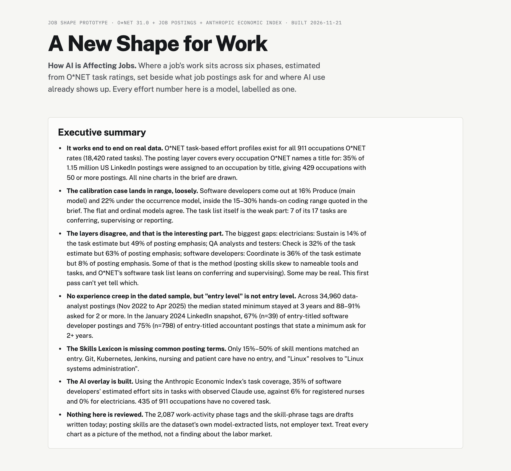
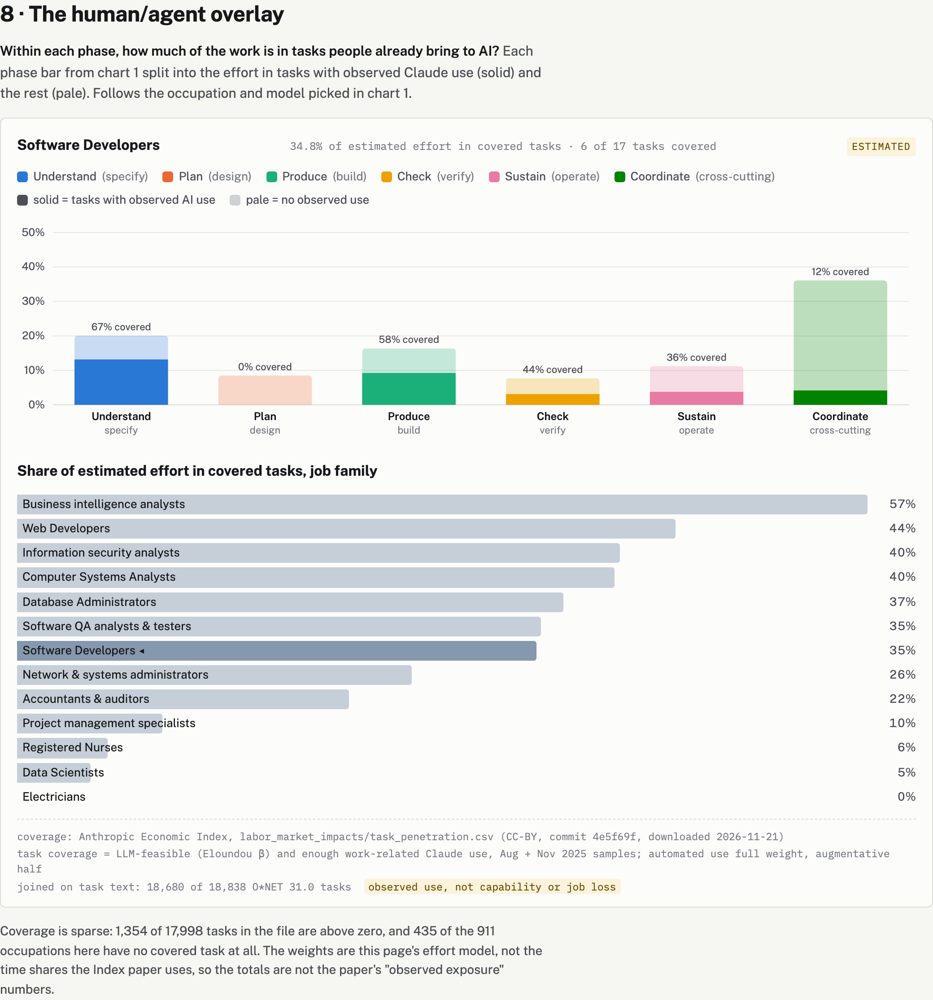
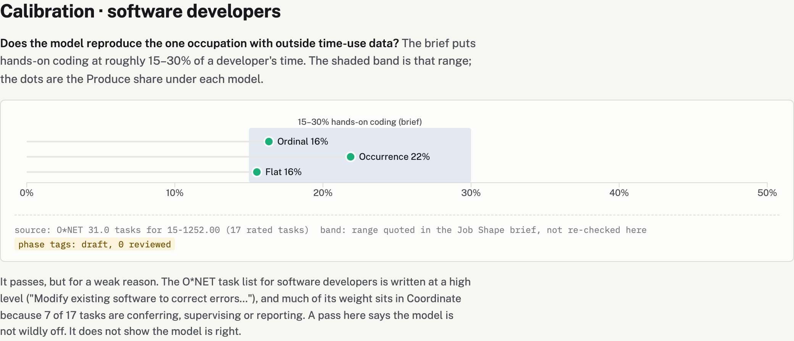
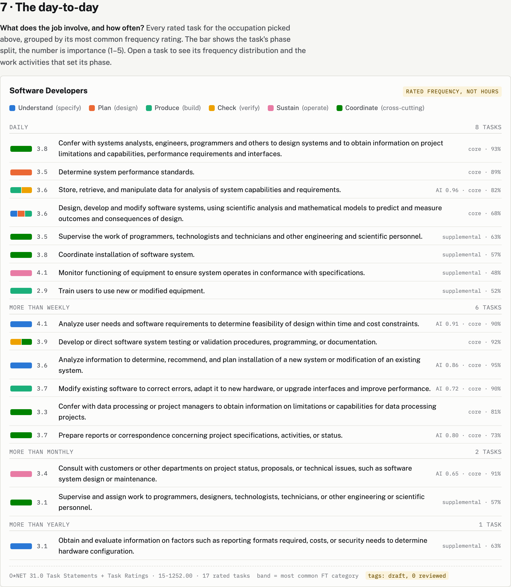
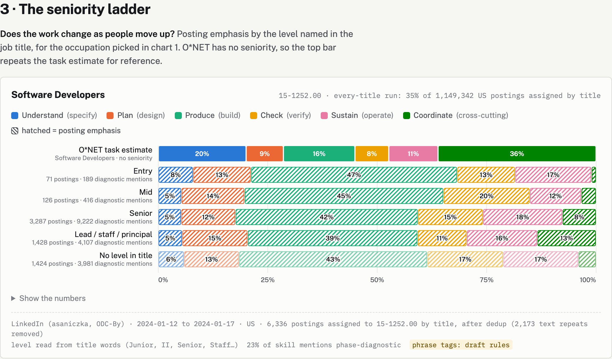
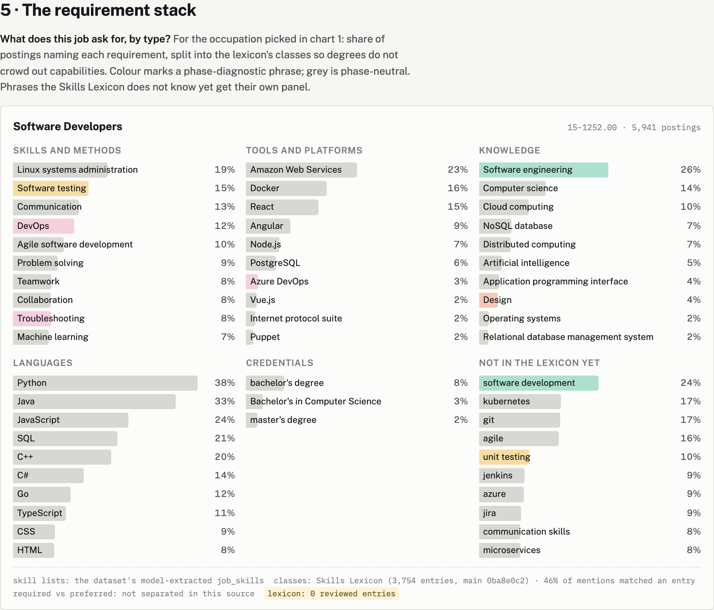
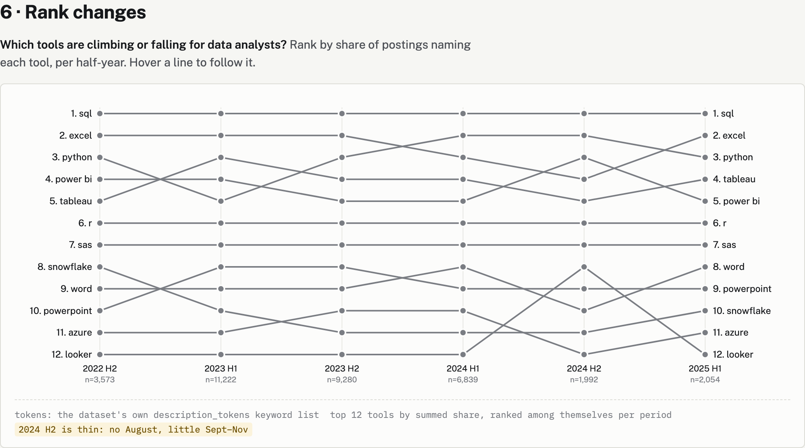
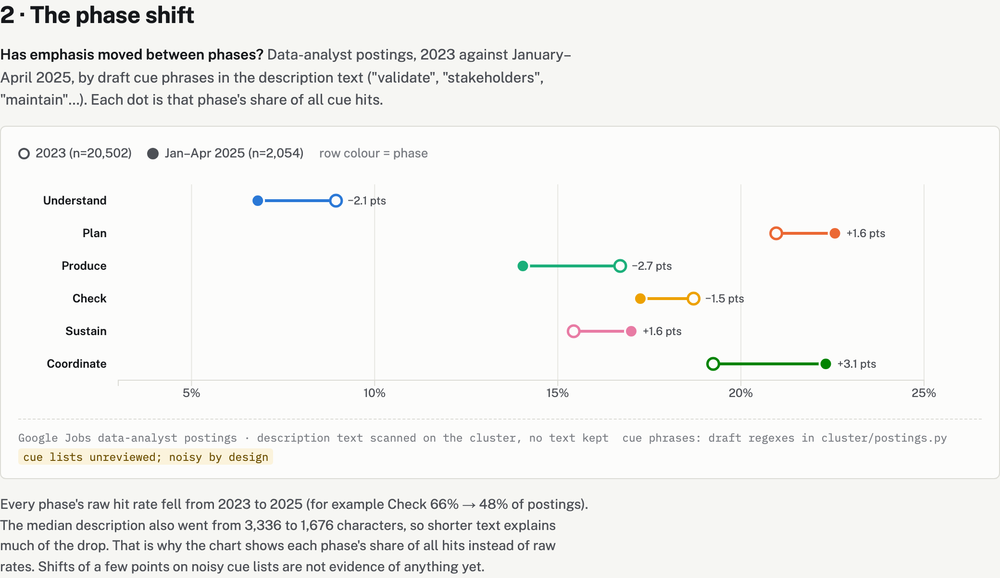

# A New Shape for Work

**What jobs involve, what employers advertise, and where AI use is visible**

[Read the working draft](paper/manuscript.md) · [Help with the paper](CONTRIBUTING.md) · [Download the research data](research-data/)

*A New Shape for Work* compares three ways of describing an occupation: how its work activities are rated, what employers emphasize in ads, and where published evidence of Claude use shows up. The prototype is a first pass. Its activity shares are modeled, not measured hours, and its phase tags are draft judgments.

**We're inviting collaborators.** Review one claim, check a source, bring an example from an occupation you know, or help reproduce a result. You don't need cluster access to contribute to the paper. AI agents can make the same judgments independently with the kit in [replication/](replication/), so models can be compared and their disagreements reviewed first.

## Abstract

An employer can advertise for software developers who write code and then hire them into work that requires substantial coordination. A task inventory and a job ad can both describe that job accurately while emphasizing different things. This paper presents a prototype for comparing three views of an occupation: the mix of activities described in O*NET, the emphasis of job advertisements, and the portion of modeled activity weighted by published evidence of Claude use. The prototype organizes work into six phases: understand, plan, produce, check, sustain, and coordinate. It builds activity profiles for 911 O*NET occupations. In a U.S. subset of a LinkedIn job-ad collection, the title matcher assigned 406,172 of 1,149,342 rows to occupations before duplicate removal; 409 rated occupations had enough mapped postings for a side-by-side profile. In the pilot, checking accounts for 32% of the task-weight index for software quality assurance analysts and testers, compared with 63% of their phase-diagnostic posting mentions. Differences like this help identify what to investigate. The prototype presents the comparison as paired phase bars, shows how activity profiles differ across occupations, and lets readers trace the AI overlay to the underlying rated tasks. The denominators differ, and the prototype measures neither time on the job nor the effects of AI on employment.

## Where the draft is

The working draft is [paper/manuscript.md](paper/manuscript.md).

## What needs to be done

- Review the phase tags and the title decisions, which are still draft judgments.
- Find better worker-side evidence, such as interviews, task diaries and time-use studies.
- Check the headline results by reproducing them from the data deposit.

The detail is in [Status and open decisions](#status-and-open-decisions).

## How to contribute

Read the [contributor guide](CONTRIBUTING.md). It lists each kind of contribution with where to start and what to send, the rules for this repo, how to submit, and how credit and authorship work.

- **A quick contribution:** open an issue about one claim, source or decision. You don't need to review the whole paper.
- **To become an author:** take on a component of the work, help write the paper, approve the final version and agree to be accountable for it. The guide explains each step.

## Executive summary

- **The prototype works end to end on real data.** O*NET 31.0 task ratings give an estimated effort profile across six phases of work (understand, plan, produce, check, sustain, coordinate) for all 911 occupations O*NET rates. Job postings give a second layer: what employers ask for. The Anthropic Economic Index gives a third: which tasks people already bring to Claude.
- **The layers disagree, and that is the paper's opening.** QA analysts and testers: Check is 32% of the task estimate but 63% of posting emphasis. Software developers: Coordinate is 36% of the task estimate but 8% of diagnostic posting mentions. Electricians: Sustain is 14% against 49%.
- **The AI overlay varies by occupation.** Weighting the activity index by published task penetration yields 35% for software developers, 6% for registered nurses, and 0% in this model for electricians. These are index values, not hours spent using AI. A zero is not proof of no AI use.
- **Weighting changes the estimate.** The modeled Produce share for software developers ranges from 16% to 22% across three weighting choices. Hands-on coding time is a different measure and does not validate this index.
- **"Every job title" is a data-gathering job, not a modelling one.** The activity index covers 911 rated occupations; the AI overlay depends on matched task scores. The posting layer needs each posting's title mapped to an occupation. Matching against O*NET's 47,839 normalised titles (exact, then longest leading or trailing words) assigned 35% of 1,149,342 US LinkedIn postings to an occupation; 19% had an ambiguous title and 45% matched nothing. 915 occupation codes received postings; 429 met the 50-ad chart cutoff. Of the 911 rated occupations, 409 met that cutoff and can be shown side by side. The most common unassigned titles ("manager", "assistant manager", "store manager", "physician") are listed for review. [docs/GATHERING-DATA.md](docs/GATHERING-DATA.md) is the step-by-step.

## What the page looks like

The prototype is one static page (`page/index.html`). These screenshots show it with software developers selected; on the page, a search box switches every occupation-level chart to any of the 911 occupations. `python3 -I scripts/take_screenshots.py` regenerates them.



**Chart 1, the phase profile.** Where the work sits across six phases: the O*NET task estimate (solid) against what LinkedIn postings ask for (hatched).


**Chart 8, the AI overlay.** Each phase split into effort in tasks with observed Claude use and the rest, with the job family ranked by covered share.



**Chart 9, the job family.** Thirteen occupations on one axis, including three outside software to test the frame.


<details>
<summary>The other charts: calibration, day-to-day tasks, seniority ladder, requirement stack, experience, rank changes, phase shift</summary>

**Calibration.** Software developers' Produce share under the three effort models, against the 15–30% hands-on coding range quoted in the design brief.



**Chart 7, the day-to-day.** Every rated task for the occupation, grouped by how often it is done. Each bar is the task's phase split, the number is its importance (1–5), and a badge marks tasks with observed Claude use.



**Chart 3, the seniority ladder.** Posting emphasis by the level named in the job title (entry, mid, senior, lead). O*NET has no seniority, so the top bar repeats the task estimate for reference.



**Chart 5, the requirement stack.** The share of postings naming each requirement, split by Skills Lexicon class. Phrases the lexicon does not know yet get their own panel.



**Chart 4, experience requirements.** The first stated minimum years of experience in data-analyst postings, one ridge per year, then by level for the LinkedIn occupations.


**Chart 6, rank changes.** Tools ranked by the share of data-analyst postings naming them, per half-year, Nov 2022 to Apr 2025.



**Chart 2, the phase shift.** Data-analyst postings, 2023 against early 2025, by phase cue phrases in the description text.



</details>

## What is here

| Path | What it holds |
|---|---|
| [paper/](paper/) | Rough manuscript and ways to help review or develop it. |
| [research-data/](research-data/) | Downloadable activity and posting tables, data sources, licenses, and reproducibility notes. |
| [page/](page/) | The prototype: `index.html` plus its three data files. Open it through any static server (`python3 -m http.server -d page 8765`). |
| [CONTRIBUTING.md](CONTRIBUTING.md) | Ways to help write, check, and reproduce the paper |
| [docs/GATHERING-DATA.md](docs/GATHERING-DATA.md) | How to gather the data and run the analysis for every job title |
| [docs/METHOD.md](docs/METHOD.md) | The phase frame, the effort models, the posting and AI layers, and where each breaks |
| [docs/job-shape-brief.md](docs/job-shape-brief.md) | The design brief the prototype was built from (charts, feasibility, build order) |
| [tags/](tags/) | The judgments: phase tags for O*NET work activities (332 intermediate, 2,087 detailed) and for posting skill phrases, and hand decisions for ambiguous job titles. All `draft`, none reviewed. |
| [docs/screenshots/](docs/screenshots/) | PNG screenshots of the page, one per chart |
| [scripts/](scripts/) | Mac-side steps, in run order (see GATHERING-DATA) |
| [cluster/](cluster/) | Explorer-side extraction (Slurm jobs, stdlib Python) |
| [replication/](replication/) | A kit for other AI agents to make the same judgments independently and in parallel: tag the work activities, job titles and skill phrases, hand in, compare |

Not in git: `source/` (downloaded inputs; `scripts/fetch_sources.sh` recreates it) and `data/` (intermediate outputs; the scripts recreate it).

## Reproduce the prototype

```bash
bash scripts/fetch_sources.sh
python3 -I scripts/phase_tags.py && python3 -I scripts/dwa_tags.py
python3 -I scripts/build_profiles.py
git clone https://github.com/nikbearbrown/skills-lexicon ../skills-lexicon
python3 -I scripts/export_lexicon_forms.py ../skills-lexicon
python3 -I scripts/make_title_map.py
# cluster steps: see docs/GATHERING-DATA.md, steps 4-6
python3 -I scripts/build_postings.py && python3 -I scripts/build_postings_by_occupation.py
python3 -I scripts/build_page_data.py
```

## Status and open decisions

- **Phase tags need review.** The most consequential one: O*NET's "Analyzing Data or Information" is tagged Understand, which sends half of a data scientist's work there.
- **Title decisions need review.** `tags/title-decisions.tsv` holds six draft choices (data analyst, project manager, QA engineer, QA analyst, customer service representative, and account executive excluded).
- **The paper is a working draft.** Its next priorities are review of the phase and title labels, better worker-side evidence, and checks on the headline results. Authorship is not yet decided.
- **Open for collaborators.** See [CONTRIBUTING.md](CONTRIBUTING.md).

## Licence

Copyright (c) 2026 Humanitarians AI Incorporated.

- **Code** (`scripts/`, `cluster/`, `page/index.html`, `research-data/export-profiles.py`): MIT, in [LICENSE](LICENSE).
- **Data, tags, documentation and screenshots** (`tags/`, `page/data/`, `docs/`, the Markdown files): CC BY 4.0, in [LICENSE-CC-BY.md](LICENSE-CC-BY.md).

The data are built from the sources below, and their attribution terms apply too.

## Data credits

- O*NET 31.0 Database, U.S. Department of Labor, Employment and Training Administration (USDOL/ETA), used under CC BY 4.0. O*NET® is a trademark of USDOL/ETA.
- Anthropic Economic Index, `labor_market_impacts/task_penetration.csv` (dataset commit 4e5f69f), data CC-BY. Method: Massenkoff and McCrory, "Labor market impacts of AI: A new measure and early evidence", 2026-03-05.
- asaniczka, "1.3M LinkedIn Jobs & Skills (2024)", Kaggle, ODC-By. Luke Barousse, "Data Analyst Job Postings (Google Search)", Kaggle, Apache 2.0.
- Skills Lexicon, github.com/nikbearbrown/skills-lexicon (main at 0ba8e0c2), for skill classes.
