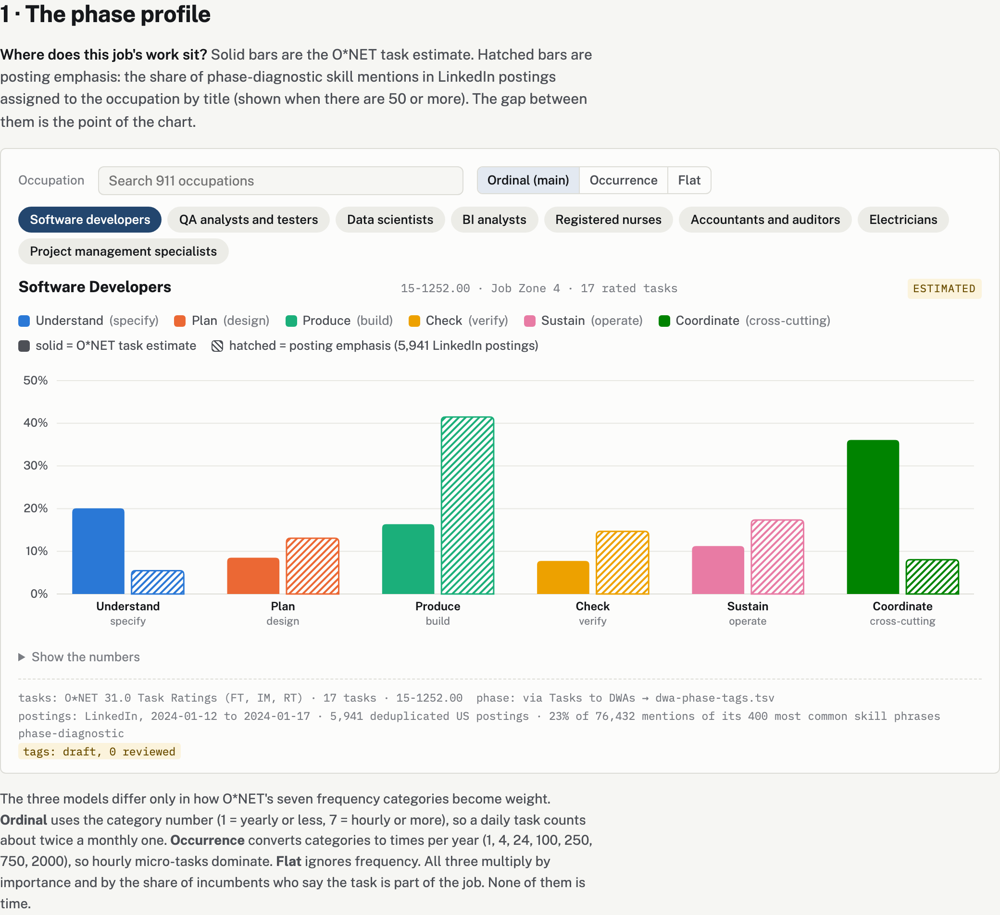
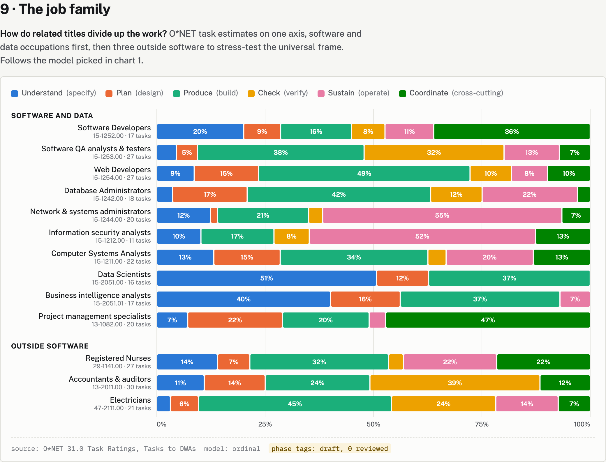
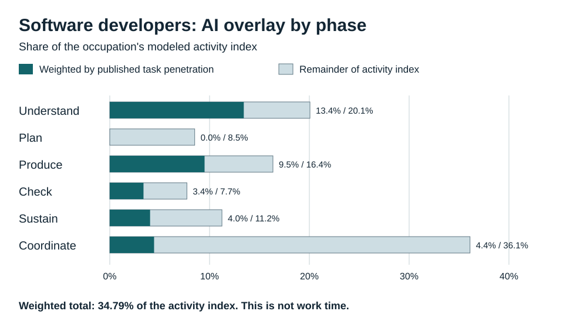
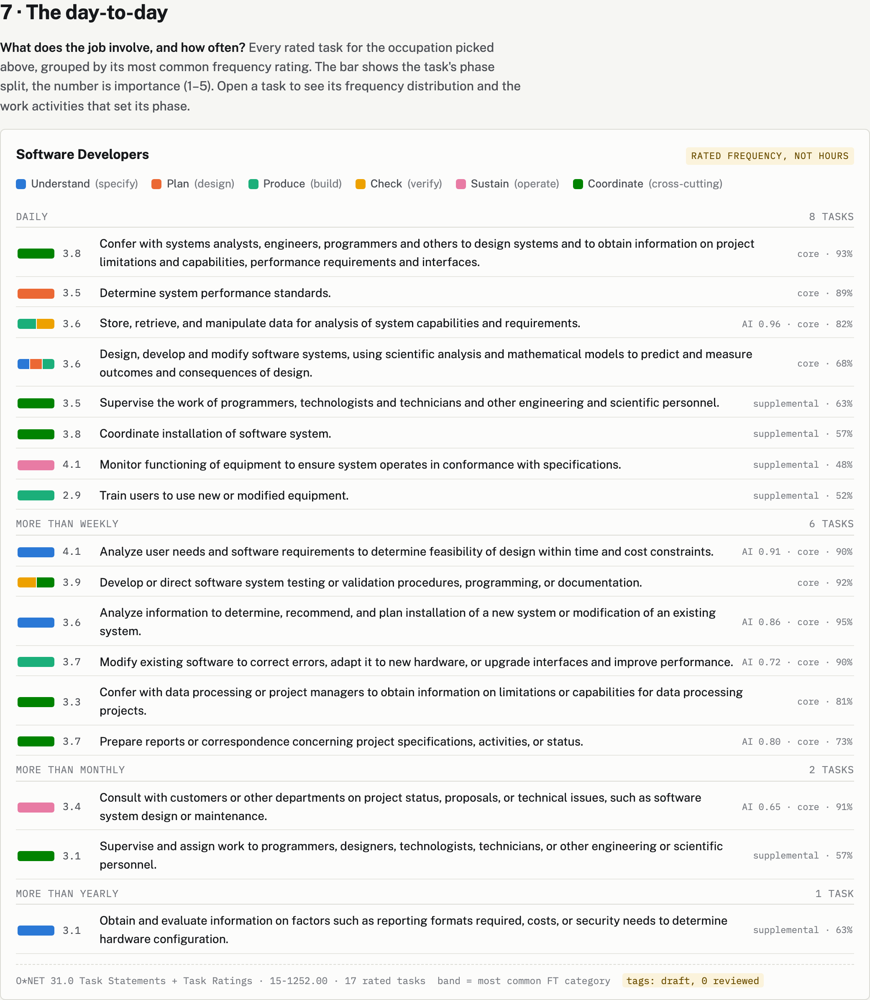

# A New Shape for Work

*What jobs involve, what employers advertise, and where AI use is visible*

**Critique revision candidate · 27 November 2026 · For author review**

Preserves the original manuscript’s prototype evidence. This revision does not report a fresh run or independent validation.

## Abstract

An employer can advertise for software developers who write code and then hire them into work that requires substantial coordination. A task inventory and a job ad can both describe that job accurately while emphasizing different things. This paper presents a prototype for comparing three views of an occupation: the mix of activities described in O*NET, the emphasis of job advertisements, and the portion of modeled activity weighted by published evidence of Claude use. The prototype organizes work into six phases: understand, plan, produce, check, sustain, and coordinate. It builds activity profiles for 911 O*NET occupations. In a U.S. subset of a LinkedIn job-ad collection, the title matcher assigned 406,172 of 1,149,342 rows to occupations before duplicate removal; 409 rated occupations had enough mapped postings for a side-by-side profile. In the pilot, checking accounts for 32% of the task-weight index for software quality assurance analysts and testers, compared with 63% of their phase-diagnostic posting mentions. Differences like this help identify what to investigate. The prototype presents the comparison as paired phase bars, shows how activity profiles differ across occupations, and lets readers trace the AI overlay to the underlying rated tasks. The three profiles are displayed together for inspection, not treated as interchangeable measures. No series measures job time, and their comparison does not estimate AI’s effect on employment.

## 1. Why describe the shape of a job?

A job title tells us little about how the work gets done. An electrician may install equipment, inspect an installation, troubleshoot faults, and coordinate with another trade. All four activities belong to the same job. Yet a job ad may say much more about troubleshooting than installation. It might do so because troubleshooting is difficult to hire for, because the opening is on a maintenance crew, or because the posting template emphasizes it. None of those explanations tells us how the worker spends a day.

AI makes this distinction especially important. A tool that helps draft code might shorten one step in a software project while increasing the need to check its output or coordinate changes across teams. That is a hypothesis about how work changes. An ad mentioning code review, or a dataset showing that people ask Claude to help with programming, does not by itself establish that such a shift has happened.

**Research question.** What can we learn by comparing these views on the same set of work phases, and what evidence does a reader need to interpret their differences?

We use *job shape* to mean the distribution of a specified measure across phases of work. We compare three measures rather than collapse them into one index. For workers and educators, the comparison can help distinguish what gets someone hired from what they need to practice. For researchers, it identifies questions that require better evidence. Is a skill genuinely more central to an occupation, or merely more prominent in recruiting language? Is AI being used for a task because it saves work, because it helps someone do better work, or because the task is easy to try in a chat interface?

## 2. Related work

Task-based accounts of technological change shift attention from occupational titles to the activities that workers perform. Autor, Levy, and Murnane (2003) used that distinction to investigate how computerization could change the task composition of employment. We take the task as a unit of analysis but do not estimate a historical effect of technology. Our contribution is a way to display comparable profiles while keeping the evidence for each profile separate.

Deming and Kahn (2018) used job advertisements to study variation in employer skill requirements. Their work motivates treating recruiting text as informative in its own right. Our question is narrower: how does emphasis in an ad corpus line up with an independently constructed occupational task profile? Massenkoff and McCrory (2026) combine evidence about language-model capabilities with work-related Claude use to study AI exposure. We reuse their published task-level measure, but apply the prototype's own task weights. Our aggregates therefore should not be read as reproductions of their exposure estimates.

## 3. Methods

### 3.1. Study design and sources

This is a descriptive measurement and visualization study, not an experiment. The common display unit is an occupation identified by its O*NET-SOC code. The three contrasts below illustrate the tool on different types of work rather than estimate population averages. The inputs to the three measures have different units and dates.

| Layer | Input unit and source | Coverage in this analysis |
|---|---|---|
| Activity | Rated occupation-task pair in the O*NET 31.0 release | 18,420 rated tasks across 911 occupation codes. Release date does not imply a common rating date. |
| Recruiting emphasis | Distinct normalized skill phrase per retained ad, from the LinkedIn corpus | 1,149,342 U.S. source rows; first-seen dates of retained records January 12–17, 2024 |
| AI overlay | Published task penetration score, Anthropic Economic Index | Work-related Claude usage evidence from August and November 2025; 18,263 matched rated task records in this analysis |

The versioned [source manifest](../research-data/SOURCE-MANIFEST.json) identifies the source releases and checksums of the data used in the figures. The [data deposit](../research-data/) gives the analysis tables; the [gathering guide](../docs/GATHERING-DATA.md) describes the full build. The dashboard screenshots below are prototype examples, not evidence from a user evaluation.

### 3.2. Six phases

The phases describe the function an activity serves, not a fixed sequence. **Understand** means gathering information or assessing a situation. **Plan** means deciding what to do and how. **Produce** means carrying out the work or delivering the service. **Check** means inspecting, testing, or evaluating its quality. **Sustain** means maintaining something already in operation. **Coordinate** means aligning work across people. One task can contribute to more than one phase. The same activity can serve different purposes in different occupations. An analyst may analyze data to decide what to do next, or the analysis may be the product the client asked for.

### 3.3. Occupational activity

We used O*NET 31.0 task statements, ratings, and links to detailed work activities. The phase rules begin with 41 generalized work activities, refine the mapping at 332 intermediate activities, and assign draft labels to 2,087 detailed work activities. A task divides its weight equally across its linked detailed activities. All phase tags in this first pass are draft judgments.

Retain tasks with a reported importance rating and a nonempty frequency distribution. For task $t$, let $p_{tk}$ be the normalized share in frequency category $k$, $I_t$ the importance rating (1–5), $R_t$ the relevance fraction (0–1; default 1 if missing), and $a_{tq}$ the fraction of linked detailed activities assigned to phase $q$. For example, if two of three links are tagged Check, two-thirds of the task's weight goes to Check.

$$
w_t = I_t R_t \sum_{k=1}^{7} k p_{tk},
\qquad A_q = \frac{ \sum_t w_t a_{tq}}{\sum_t w_t}.
$$

We call $A_q$ the activity index share. The dashboard labels it estimated effort. The primary index treats the seven ordered categories as scores 1–7. The occurrence variant substitutes 1, 4, 24, 100, 250, 750, and 2,000 assumed events per year. The flat variant uses 1 for each category. Both recompute the denominator. A task must have a phase link to contribute; all rated tasks in this snapshot did. None of these specifications measures task duration. [Profile builder](../scripts/build_profiles.py).

### 3.4. Recruiting emphasis

The posting pilot uses Asaniczka’s LinkedIn collection (Kaggle v2). It filters on the source field `search_country = United States`, which is not a validated work location. The retained records were first seen January 12–17, 2024. The matcher compares normalized listing titles with O*NET titles and aliases, using an exact match first. If the exact title is missing, it tries the longest resolving leading sequence of at least two words, then the longest resolving trailing sequence. Exact ambiguous or excluded titles stay unresolved rather than falling through. A title assignment is a proposed link, not an audited classification. To reduce repeated ads, the pipeline first deduplicates by occupation, company, title, and location, then compares normalized summary hashes within an occupation. These rules can still miss duplicate vacancies and can collapse genuinely separate openings.

The phase analysis uses the dataset's extracted skill phrases, not a new human annotation of each original ad. Each normalized phrase contributes at most once per retained ad. Within each occupation, the prototype scores up to the 400 most common phrases using the ordered [phase rules](../scripts/build_postings.py). A phrase such as code review can signal Check; a tool name alone does not reliably identify a phase. Let $D_q$ be the count assigned to phase $q$. The reported share is $D_q/\sum_j D_j$ when diagnostic mentions exist. This is not the percentage of ads or of hires. The public comparison uses a display cutoff of at least 50 retained ads per occupation. The separate Google Jobs data-analyst series illustrates a longitudinal interface and is not used for the three contrasts below or to infer a general trend.

### 3.5. AI-use evidence

We link the Anthropic Economic Index's published task-penetration file to O*NET task text after normalizing case and whitespace. The published score reflects eligibility and observed work-related Claude use under the source's criteria, with automated use weighted more heavily than augmentative use. Let $u_t$ be the published penetration score for task $t$. In phase $q$ the darker overlay is $C_q = \sum_t w_t a_{tq} u_t / \sum_t w_t$. Consequently $C_q$ is a share of the occupation's full activity index, $C_q/A_q$ is the penetration-weighted fraction within the phase when $A_q>0$, and $\sum_q C_q$ is the occupation-level index. The count of tasks with positive scores is a separate, binary count. The implementation contributes zero to the numerator for an unmatched task. Across rated task records, 157 joins were missing; future versions should show missing joins separately from matched zero scores. The overlay does not represent all AI tools, the fraction of workers using AI, or the probability that a job will be automated.

### 3.6. Visualization design

The prototype uses a fixed phase order and explicit denominators. Paired solid and hatched bars compare phase profiles for one occupation (Figure 1). Stacked bars on a common 0–100% scale compare activity composition across occupations (Figure 2). A lighter remainder behind each darker AI-overlay bar shows how much of the activity index is outside that weighted portion (Figure 3). The task drill-down exposes the ratings and phase assignments underneath each aggregate (Figure A1). The screenshots retain the prototype's terminology; the captions give the precise statistical definitions. This design lets readers trace a visible difference back to the data and assumptions, rather than taking the gap as a result about real hours or hiring outcomes.

## 4. What the prototype shows

The examples are selected prototype contrasts, not a representative sample of all occupations. All counts below are carried forward from the versioned working draft. No map-wide inference is attempted.

Of 1,149,342 U.S. rows in the LinkedIn snapshot, 406,172 (35.34%) were assigned before deduplication, 216,975 (18.88%) were ambiguous, 521,332 (45.36%) did not match, and 4,863 (0.42%) were explicitly excluded. About a third of assignments (134,405) used leading- or trailing-phrase matches. The two duplicate filters left 277,976 records. The posting layer returned mapped records for 915 occupation codes; 429 met the minimum of 50 retained postings. Of the 911 occupations with O*NET activity profiles, 849 had some posting coverage and 409 met that threshold. Fifty is a display cutoff, not a test of precision or representativeness.

| Occupation | Phase | Share of task-weight index | Share of diagnostic ad mentions | Retained ads | Diagnostic mentions |
|---|---|---:|---:|---:|---:|
| Software quality assurance analysts and testers | Check | 32.28% | 62.76% | 543 | 2,672 |
| Software developers | Coordinate | 36.10% | 8.02% | 6,336 | 17,915 |
| Electricians | Sustain | 14.40% | 48.70% | 686 | 2,193 |

These are useful contrasts precisely because the columns answer different questions. An ad may foreground testing because testing differentiates an opening. Coordination may be common in software development but less often captured by the extracted skill list or rules. A hiring corpus may also contain more maintenance openings than the electrician task inventory would lead one to expect. The pilot does not distinguish these explanations. A gap should direct attention to the ads, tagging rules, and workers' accounts before it guides a curriculum or a staffing decision.

Figure 1 shows how one of the table's contrasts appears alongside the other phases. The occupation's coordination share is highest on the activity side, while the recruiting measure emphasizes production. The point of the comparison is to decide what to inspect next: the task definitions, the types of openings in the ads, or the classification of phrases.

**Figure 1. Activity and recruiting emphasis for Software Developers (15-1252.00).** Existing prototype screenshot. Solid bars are shares of the ordinal activity index for 17 rated tasks; hatched bars are shares of 17,915 diagnostic mentions out of 76,432 mentions of the most frequent skill phrases. The dashboard's 5,941 is the number of retained ads with skill phrases (6,336 retained in total). Coordinate is about 36% of the first measure and 8% of the second. Neither series measures time spent on a phase. The figure shows software developers only; the table reports the QA and electrician comparisons.

Figure 2 holds the data source and weighting model constant and varies the occupation. The same six categories make software development, QA, accounting, nursing, and electrical work comparable without assuming that they have the same duties. Small phase shares may be too narrow for their labels to appear.

**Figure 2. Comparing modeled activity profiles across occupations.** Existing prototype screenshot. Each bar sums to 100% of the occupation's ordinal task-weight index, subject to rounding. Among the displayed profiles, software developers have about 36% in Coordinate and QA analysts and testers about 32% in Check. This is a comparison of draft classifications and task ratings, not a time-use comparison.

The direction of each gap survives the two alternate weighting choices: QA Check ranges from 26.90% to 34.14%; developer Coordinate, 30.75% to 36.40%; and electrician Sustain, 12.39% to 18.53%. That is a check on frequency weights only. No alternative phase annotations were used. Even among the 400 most common phrases, only 41.84%, 23.44%, and 27.70%, respectively, were diagnostic in these three cases.

The penetration-weighted activity index is 34.79% for software developers and 6.09% for registered nurses; it is zero in the prototype for electricians. A zero says the matched source and model contributed nothing under this definition. It does not establish that electricians make no use of AI. Separately, weighting sensitivity is visible even for a familiar role: software developers' Produce share is 16.35% under the ordinal model, 21.87% under the occurrence model, and 15.54% under the flat model. This comparison measures sensitivity to the weighting assumptions, not agreement with an independent observation of working hours.

Figure 3 shows what the AI overlay adds to the activity view. It redraws the same data as the [original prototype screenshot](../docs/screenshots/chart-8-ai-overlay.png) with labels that distinguish weighted scores from counts of tasks. The lighter portion cannot be interpreted as human-only work. For example, it includes the residual contribution from a task whose published score is positive but less than one.

**Figure 3. Penetration-weighted activity for Software Developers.** The weighted portion totals 34.79% of the ordinal activity index. Six of 17 rated tasks had positive scores; 34.79% is not an unweighted share of those tasks. Each label shows the weighted and total phase shares of the full occupation index, respectively. Light segments include the remainder of positive-score tasks and all the weight of zero-score or unmatched tasks. A displayed zero is not a claim about what AI can do, or whether anyone in that occupation uses AI. [Figure source](../paper/figures/build-ai-overlay.py).

## 5. Limits and the next test

The sources describe different periods. The O*NET release date is not the date every occupation was observed. For example, the developer task ratings are from incumbents in August 2025, while the QA ratings are from occupational experts in August 2022. The prototype also retains rating cells flagged for recommended suppression. A sensitivity check should use the [O*NET quality flags and sample metadata](https://www.onetcenter.org/dictionary/31.0/csv/task_ratings.html) and report how results change when flagged cells are excluded.

The immediate priority is to validate the links before broadening the corpus. Record a weighted coverage diagnostic for each phase: the sum of task weight assigned to that phase with any matching penetration record divided by all task weight assigned to the phase. Display it alongside the score, retaining its separate denominator. A missing join should never be visually indistinguishable from an observed zero. [NEEDS: computed weighted coverage by phase and alternative treatment of missing joins before a headline comparison.] A stratified review should include direct, ambiguous, and unmatched titles, as well as multiple industries and seniority levels. A reviewer should see the duties alongside the title. For phase classification, two reviewers can tag the same activities independently, record alternative labels when the phase depends on context, and adjudicate disagreements. The repository includes a replication kit for independently tagging work activities, titles, and skill phrases; agreement between models can identify review targets but does not establish accuracy.

The strongest test would compare job ads, worker accounts, and task diaries from the same kinds of jobs. That design could distinguish recruiting emphasis from task frequency and measured time. It could also test whether work shifts from production toward checking or coordination after AI enters a workflow. Such a study would need a comparison over time and a credible way to account for changes in employers, job composition, and selection into AI use.

A practical next step is to choose occupations with both large gaps and small gaps as controls and ask, for each one, whether the gap survives review of the title match, the phase tag, and actual worker descriptions. If the gap disappears, the prototype has identified a measurement error. If it persists, it has identified a question worth investigating about how employers describe work and how workers do it.

## Appendix A. Audit trail from tasks to the profile

The task drill-down (Figure A1) makes it possible to ask which rated tasks contribute to a phase. It exposes the ratings and draft assignments that can be checked with workers and domain experts. The interactive version is available in the [prototype](../page/).

**Figure A1. Inspecting the 17 rated software-developer tasks.** Existing prototype screenshot. Frequency groups use each task's most commonly reported frequency category. The 1–5 numbers are importance ratings; the colored segments divide tasks across phases. The right-hand percentages are rated relevance, not frequency or time. Where shown, AI badges give task penetration scores. The group labels are not a diary of a workday.

The repository also has exploratory views of [posting shifts](../docs/screenshots/chart-2-phase-shift.png), [seniority](../docs/screenshots/chart-3-seniority-ladder.png), [stated experience](../docs/screenshots/chart-4-experience.png), [requirements](../docs/screenshots/chart-5-requirement-stack.png), and [rank changes](../docs/screenshots/chart-6-rank-changes.png). These interface examples use different samples or denominators. They do not establish a market-wide time trend, and are not evidence for this paper's headline comparisons.

## References and data

- Autor, D. H., Levy, F., and Murnane, R. J. (2003). [The Skill Content of Recent Technological Change: An Empirical Exploration](https://doi.org/10.1162/003355303322552801). *Quarterly Journal of Economics*, 118(4), 1279–1333.
- Deming, D., and Kahn, L. B. (2018). [Skill Requirements across Firms and Labor Markets: Evidence from Job Postings for Professionals](https://www.nber.org/papers/w23328). *Journal of Labor Economics*, 36(S1), S337–S369. Link leads to the authors' working-paper version.
- Massenkoff, M., and McCrory, P. (2026). [Labor market impacts of AI: A new measure and early evidence](https://www.anthropic.com/research/labor-market-impacts). Anthropic. [Published data release](https://huggingface.co/datasets/Anthropic/EconomicIndex/tree/4e5f69fab13a9c3f7d0dcc31a6f893a9818738f6/labor_market_impacts).
- U.S. Department of Labor, Employment and Training Administration. [O*NET 31.0 Database](https://www.onetcenter.org/dl_files/database/db_31_0_text.zip). Used under [CC BY 4.0](https://www.onetcenter.org/license_db.html). O*NET is a trademark of USDOL/ETA.
- Asaniczka. [1.3M LinkedIn Jobs & Skills (2024)](https://www.kaggle.com/datasets/asaniczka/1-3m-linkedin-jobs-and-skills-2024). Corpus source; see repository documentation for transformation and rights notes.
